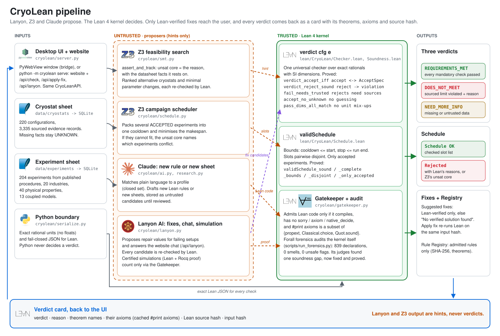
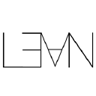
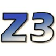

# CryoLean


Cyrostat Digital Twin Lean Proved

**Cryo, made simple.** CryoLean answers one question: *can this cryogenic machine physically perform my
experiment under its actual operating conditions?* The product proposal is in [docs/PRODUCT.md](docs/PRODUCT.md).
Built for the [VibeCheck FM + AI Hackathon](https://fmxai.org/vibecheck/).

## Pipeline



<sub>Regenerate with `python scripts/make_pipeline_svg.py`.</sub>

## Built with

| | Tool | Where it sits | What it does here | Trusted? |
|:-:|---|---|---|---|
|  | **Lean 4** | `lean/CryoLean/` | `verdict cfg e` and `validSchedule`, compiled to the checker binary. 44 audited theorems, standard axioms only. Also the Gatekeeper's judge: proposed code is admitted only if the Lean kernel accepts it. | **Yes: the only source of verdicts** |
|  | **Forall forensics** | `scripts/run_forensics.py`, [docs/forensics](docs/forensics/README.md) | Audits the kernel itself: 839 declarations, 0 smells, 0 unsafe flags. Its judges found a real soundness gap, now fixed and proved. | Auditor |
|  | **Z3** | `cryolean/smt.py`, `cryolean/schedule.py` | Unsat cores (why it fails), ranked alternatives, parameter fixes, campaign packing with minimum makespan. Every output is re-checked by Lean. | No: a hint |
|  | **Claude** | `cryolean/ai.py`, `cryolean/research.py` | Matches plain language to a prepared profile and drafts new rules or sheets. Drafts stay untrusted until reviewed. | No |
|  | **Lanyon AI** | `cryolean/lanyon.py` | The AI proposer and assistant. Proposes repairs for failing setups (each candidate is Lean-checked before it is shown; `proposed_by: lanyon`) and answers the website chat (`POST /api/lanyon`). Also certified simulations: specify, verify (exported Lean + Rocq proof), compile, simulate; a result counts as `certified_simulation` only if its Lean proof passes the Gatekeeper. Enable with `CRYOLEAN_LANYON_PROPOSER=1`. | No: proposals are hints Lean re-checks |
|  | **SQLite** | `data/cryolean.db` | Catalog built from the JSON seeds: 667 sourced records, 26 configurations, 11 experiment profiles, 40 properties, 13 coupled models, plus the rule Registry. | Data, validated |
|  | **Python** | `cryolean/` | Exact unit conversion, fail-closed JSON for Lean, orchestration. | Never decides a verdict |
|  | **PyWebView** | `cryolean/desktop.py`, `cryolean/bridge.py` | Native Windows window; the UI calls `window.pywebview.api.*`. No web server. | Transport |
|  | **Codex** | `frontend/` | The UI, built with Codex: a React app that runs in the PyWebView window and calls the bridge through [docs/codex/cryolean-client.js](docs/codex/cryolean-client.js); see [FRONTEND_INTEGRATION.md](FRONTEND_INTEGRATION.md). | Display only |

## How the code differs from the original sketch

The architecture sketch is implemented as drawn. These are the places where the code uses different names or adds a step.

| In the sketch | In the code |
|---|---|
| `decideRun c e` | `verdict cfg e` in `lean/CryoLean/Checker.lean`, run through `run`. |
| `thm decideRun_correct: accept ↔ Requirements, deny r → violated r` | Two theorems. `verdict_accept_iff` proves accept ↔ `AcceptSpec`. `verdict_reject_sound` proves reject → a documented violation. `fail_needs_trusted` adds that every violation rests on trusted evidence. |
| ACCEPT / DENY + reason | Three verdicts. NEED_MORE_INFORMATION is the third: missing or untrusted data never becomes a pass or a fail. |
| `validSchedule` (bounds + pairwise disjoint), `thm validSchedule_bounds` | `lean/CryoLean/Schedule.lean`. `validSchedule_sound` and `validSchedule_complete` give the full spec. `_bounds` and `_disjoint` are its parts. `_only_accepted` adds that only experiments Lean accepted can be scheduled. |
| Gatekeeper (no sorry/axiom/native_decide, `#print axioms` ⊆ std) | `cryolean/gatekeeper.py`. Python runs it, but the decision is the Lean kernel's: the code must compile and `#print axioms` must list only standard axioms. Proofs that import Mathlib are compiled in a separate Mathlib workspace (`.tools/mathlib-gate`, or `CRYOLEAN_MATHLIB_PROJECT`). |
| AI proposes repairs | Lanyon proposes; Lean checks every candidate on the exact configuration Apply fix uses; only REQUIREMENTS_MET is shown. |
| LLM proposes Lean code or data | Claude (matching/drafting), and Lanyon, whose exported proofs go through the same Gatekeeper. |
| Verdict card: verdict · reason · theorem names · axioms · source hash | `verdict_card` on every result. Axioms come from `lean/audit-axioms.json`, written by `python scripts/audit_axioms.py`, and are marked stale if the Lean sources change. |

## Quick start (macOS and Linux)

```bash
make install && make run
```

`make install` installs what is missing (Python ≥ 3.11 and Node.js via Homebrew on macOS, elan for Lean), creates `.venv`, builds the
Lean checker, builds the catalog database and builds the GUI in `frontend/dist`. `make run` opens the desktop app.
`make dev` runs the GUI with hot reload in a browser against the real backend; `make test` runs the fast backend tests and
the GUI end-to-end tests. The full GUI walkthrough is in [docs/GUI_TESTING.md](docs/GUI_TESTING.md).
On Linux, PyWebView also needs GTK or Qt (see the [PyWebView installation notes](https://pywebview.flowrl.com/guide/installation.html)).

## Setup on Windows

Requirements: Python ≥ 3.11 and [elan](https://github.com/leanprover/elan) (Lean 4.35.0 is pinned in `lean/lean-toolchain`).

```powershell
pip install -r requirements.txt
```

```powershell
cd lean; lake build; cd ..
```

```powershell
python -m cryolean build-db
```

```powershell
python -m cryolean demo
```

```powershell
python -m pytest
```

Launch with the frontend (PyWebView; build it once with `npm ci --prefix frontend` and `npm run build --prefix frontend`):

```powershell
python -m cryolean.desktop --frontend frontend\dist\index.html
```

`python -m pytest` compiles every Lean proof (`lake build`) and runs the axiom audit; use `-m "not slow"` to skip those two.
Verification is fully offline once the database is built. Optional: `CRYOLEAN_AI_PROVIDER=claude` (with Anthropic API credentials) for
Claude-based matching and research drafting; the default matcher is offline.

## The demonstrations (`python -m cryolean demo`)

* **A — confirmed incompatibility.** A 10 T magnetoresistance measurement on the PPMS DynaCool 9 T: Lean rejects
  (`magnetic_field.max`), Z3's unsat core cites the Quantum Design brochure quote, and the 14 T configuration is proposed.
* **B — coupled multiphysics.** A 50-qubit wiring layout (Krinner et al., *EPJ Quantum Technology* 2019) on a Bluefors LD400
  with high-density wiring: temperature (10 mK ≤ 20 mK) and line count (168 ≥ 124) pass, but Lean computes the mixing-chamber
  heat budget `3 × (58·13 nW + 50·(29 + 50) nW + 8·20 nW) = 14.592 µW > 12 µW` and rejects. Z3 suggests 39 flux lines;
  Lean re-checks it as `REQUIREMENTS_MET` (11.985 µW ≤ 12 µW).
* **C — new industry.** Semiconductors are registered, a sourced candidate (two open-access papers using Lake Shore probe
  stations) passes the validation gate and reviewer approval, Z3 searches every configuration, the same Lean binary verifies
  the Lake Shore CRX-VF (and rejects the 2-probe-arm CRX-4K configuration for the ≥ 3-arm requirement), and the hash of the
  Lean core is unchanged.
* **D — campaign scheduling.** Four experiments for one cooldown of the Lake Shore CRX-VF over 48 h. Lean rejects the 10 T
  magnetoresistance run, so it is never scheduled. Z3 packs the other three after the documented 5 h cooldown, finishing at 23 h,
  and Lean `validSchedule` accepts the exact slot list. With a 20 h run, Z3's unsat core reports that 18 h of experiments
  cannot fit in the 15 h left.

## What is in the catalog

| Equipment | Configurations |
|---|---|
| Leica CM1950 | legacy standard; legacy vacuum + motor + object cooling; 2026 DualEcoTec |
| Linkam THMS600 | with LNP96 + T96; heating only; THMSEL600 electrical variant |
| Quantum Design PPMS DynaCool | 9 T ETO + resistivity; 14 T ETO + VSM + heat capacity; 12 T VSM |
| Quantum Design PPMS (classic) | 14 T; 16 T |
| Bluefors LD | LD250 (manual v2.0); LD400 + high-density wiring; LD450 (2026 spec) |
| Oxford Instruments TeslatronPT / OptistatDry | 8, 12, 14 T, 6-1-1 T vector / BLV, TLEX |
| Lake Shore CRX / Janis CCS | CRX-VF, CRX-4K / CCS-100, 300S, 400, 400H |

Experiment profiles (from published procedures): frozen-tissue cryosectioning; temperature-controlled cryo-microscopy;
low-temperature Raman; phase-transition microscopy (203–393 K); low-temperature resistance; VSM magnetometry (5–300 K, 9 T);
plus photoluminescence, 10 T magnetoresistance, transmon characterisation, mK vector-field transport and the qubit wiring heat budget.
Missing facts are UNKNOWN (121 capability entries); `get_research_coverage()` lists every gap.

## Repository

| Path | Contents |
|---|---|
| `lean/CryoLean/` | `Model` (universal types, SI dimensions), `Num` (exact rationals), `Checker`, `Spec` (independent specification), `Soundness` (proofs), `Schedule` (`validSchedule`), `Json`, `Explain`, `Report`; `lean/Main.lean` CLI; `lean/Audit.lean` axiom audit |
| `cryolean/` | `bridge` (desktop API), `verifier` (Lean then Z3, verdict card), `smt`, `schedule` (Z3 campaign packing), `gatekeeper` (rule Registry), `lanyon`, `serialize` (the Python→Lean boundary), `units`, `db`, `catalog`, `validation`, `research`, `modifications`, `edits`, `coverage`, `ai`, `demo`, `desktop` |
| `data/` | JSON seeds (`cryostats/`, `experiments/`, `evidence/`, `physics/`, `capability_vocabulary.json`, `industries.json`), `evidence.json`, `coverage.json`, `SCHEMA.md` |
| `research/` | raw research notes, the re-verified v2 research (`research/v2/`), new-industry candidate, the Lanyon prompts (`research/lanyon/`) |
| `docs/` | `PRODUCT.md`, `codex/cryolean-client.js`, `forensics/` (audit report), `lanyon/` (first certified session), `images/` (pipeline), real example outputs in `examples/` |
| `scripts/` | `audit_axioms.py`, `run_forensics.py`, `make_pipeline_svg.py`, `validate_sources.py`, `build_evidence.py`, `build_coverage.py`, `promote_candidate.py`, `import_research_v2.py` |
| `tests/` | 68 tests: the 20 required scenarios, engine guarantees, review regressions, Lean build + axiom audit, data and bridge |

Read [VERIFICATION_SCOPE.md](VERIFICATION_SCOPE.md) for exactly what is and is not guaranteed, and
[RESEARCH_SOURCES.md](RESEARCH_SOURCES.md) for every source.

## License

MIT — see [LICENSE](LICENSE).
