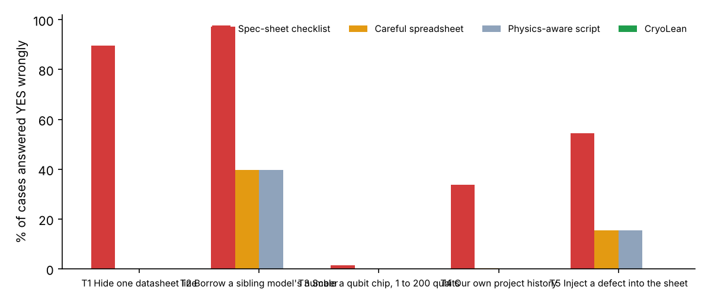
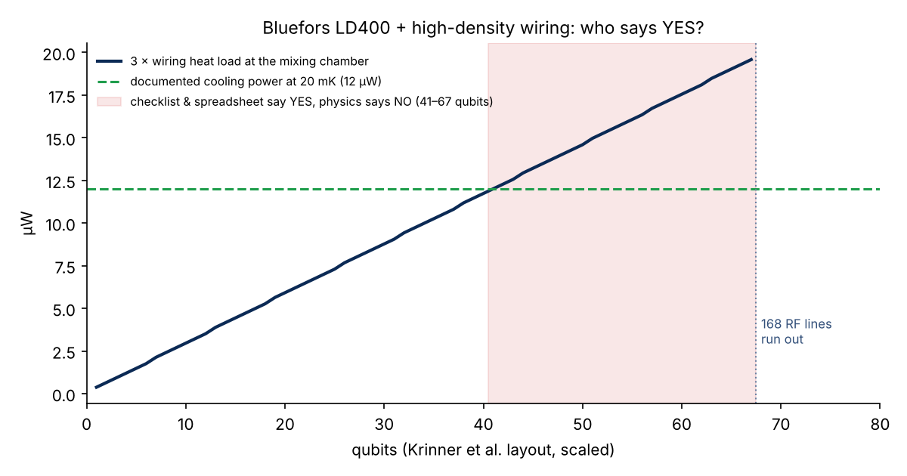

# CryoLean vs the regular way: results

Generated by `python bench/vs_regular.py && python bench/report.py` against the Lean checker with source hash `179242c369f42fb9`. Every number below is read from `bench/results/*.json`.

## Scoreboard: wrong YES answers (the dangerous error)

A wrong YES means the method approved an experiment on a configuration that the ground truth rules out (T1–T4), or certified a line the sheet cannot support (T5). The ground truth never comes from CryoLean.

| Test | Cases | Truth comes from | Spec-sheet checklist | Careful spreadsheet | Physics-aware script | CryoLean |
|---|---:|---|---:|---:|---:|---:|
| T1 Hide one datasheet line | 17,581 | the configuration's own sourced spec rules the setup out | 15,766 (89.7%) | 0 (0%) | 0 (0%) | 0 (0%) |
| T2 Borrow a sibling model's number | 496 | the configuration's own sourced spec rules the setup out | 482 (97.2%) | 197 (39.7%) | 197 (39.7%) | 0 (0%) |
| T3 Scale a qubit chip, 1 to 200 qubits | 44,000 | Krinner et al.'s published heat-budget rule, recomputed exactly | 622 (1.4%) | 27 (0.1%) | 0 (0%) | 0 (0%) |
| T4 Our own project history | 284 | documentation found after the Oct 31 build, same requirements | 96 (33.8%) | 1 (0.4%) | 0 (0%) | 0 (0%) |
| T5 Inject a defect into the sheet | 2,750 | by construction: a planted defect leaves a line uncertifiable | 1,499 (54.5%) | 422 (15.3%) | 422 (15.3%) | 0 (0%) |
| **Impossible setups approved, T1–T4** | **62,361** | | **16,966** | **225** | **197** | **0** |

## The regular way, three versions (bench/regular_way.py)

| | Reads | Blank line | Coupled physics | Unsourced numbers |
|---|---|---|---|---|
| R1 Spec-sheet checklist | one line at a time | passes | ignored | believed |
| R2 Careful spreadsheet | one line at a time | NEED INFO | ignored | believed |
| R3 Physics-aware script | lines + physics in floats | NEED INFO | computed, no validity range | believed |
| CryoLean | lines + physics, exact rationals | NEED INFO | computed inside its validity range | never decide |

All three regular methods read the same input documents as the Lean checker and respect the documented install status (a brochure option documented as not fitted counts as absent).

## T0 Catalog head-to-head (no ground truth, but a theorem)

44,880 pairs (204 experiments × 220 configurations), decided by the Lean binary in 23.7 s.

| | YES | NO | NEED INFO |
|---|---:|---:|---:|
| Spec-sheet checklist | 14,558 | 30,322 | 0 |
| Careful spreadsheet | 3,127 | 30,322 | 11,431 |
| Physics-aware script | 3,126 | 30,326 | 11,428 |
| CryoLean | 3,118 | 30,304 | 11,458 |

By `sound_yes_le_cryolean` (lean/VsRegular.lean), no checker that is never wrong can say YES where CryoLean does not, so every extra YES below is unsupported by the specification (`extra_yes_unsupported`):

* Spec-sheet checklist: 11,440 unsupported YES (datasheet silent on a required line: 11,436, coupled physics fails: 4); 22 NO without a sourced violation.
* Careful spreadsheet: 9 unsupported YES (number without a trusted source decided a line: 8, coupled physics fails: 1); 22 NO without a sourced violation.
* Physics-aware script: 8 unsupported YES (number without a trusted source decided a line: 8); 22 NO without a sourced violation.

## T1 Hide one datasheet line

Pairs that CryoLean rejects on exactly one sourced datasheet line (no coupled check failing): 17,581. We delete that line from the configuration, as if the sheet were silent on it, and rebuild the documents (anything still derivable from other lines stays). The machine did not change, so the truth is still NO.

* Spec-sheet checklist: YES 15,766, NEED INFO 0, NO 1,815
* Careful spreadsheet: YES 0, NEED INFO 15,766, NO 1,815
* Physics-aware script: YES 0, NEED INFO 15,766, NO 1,815
* CryoLean: YES 0, NEED INFO 15,809, NO 1,772
* CryoLean's NEED INFO named the hidden line in 15,809 of 15,809 cases.
* Hiding every failing line instead (30,055 pairs): checklist wrong YES 26,770, CryoLean 0.
* Example: *Measure how a crystal's resistance changes in a 10 T field at 2 K* on *PPMS DynaCool, 9 T magnet, Electrical Transport Option (ETO) + DC Resistivity*. magnetic_field.max: needs at least 10 T; sheet: a documented maximum of 9 T. Hidden: `magnetic_field.max`. Checklist YES, CryoLean NEED INFO.

## T2 Borrow a sibling model's number

Same rejected pairs, but every failing line is refilled with the value printed for another configuration of the same instrument (the 12 T column read for the 9 T magnet), recorded as what it is: an inferred estimate. 496 pairs could be refilled this way.

* Spec-sheet checklist: wrong YES 482
* Careful spreadsheet: wrong YES 197
* Physics-aware script: wrong YES 197
* CryoLean: wrong YES 0
* Example: *Measure quantized Hall conduction in graphene on a magnetic insulator* on *PPMS DynaCool, 9 T magnet, Electrical Transport Option (ETO) + DC Resistivity*. magnetic_field.max: needs at least 12 T; sheet: a documented maximum of 9 T. Borrowed from `magnetic_field.max <- qd_dynacool_12T_vsm`. Spreadsheet YES, physics script YES, CryoLean NEED INFO.

## T3 Scale a superconducting-qubit chip

Krinner et al.'s 50-qubit wiring layout scaled to 1–200 qubits on all 220 configurations (44,000 cases). Truth: base temperature ≤ 20 mK, enough RF lines, and 3 × the summed per-line heat load ≤ the cooling power documented at a temperature ≤ 20 mK, recomputed in exact fractions without Lean.

* Spec-sheet checklist: wrong YES 622, wrong NO 0, agrees with the rule on 38,892
* Careful spreadsheet: wrong YES 27, wrong NO 0, agrees with the rule on 42,697
* Physics-aware script: wrong YES 0, wrong NO 0, agrees with the rule on 43,319
* CryoLean: wrong YES 0, wrong NO 0, agrees with the rule on 43,319
* On the Bluefors LD400 with high-density wiring the rule allows 40 qubits; the checklist and the careful spreadsheet say YES up to 67 (until the 168 RF lines run out).

## T4 Our own project history

The catalog of revision `7a224f4` (Oct 31) against today's catalog, on the 284 pairs whose experiment requirements did not change. Documentation found since then decides 231 of them as NO and 25 as YES.

* Spec-sheet checklist on the Oct 31 data: YES to 96 pairs later documented NO; NO to 0 later documented YES
* Careful spreadsheet on the Oct 31 data: YES to 1 pairs later documented NO; NO to 0 later documented YES
* Physics-aware script on the Oct 31 data: YES to 0 pairs later documented NO; NO to 0 later documented YES
* CryoLean on the Oct 31 data: YES to 0 pairs later documented NO; NO to 0 later documented YES

## T5 Fault injection

2,750 synthetic configurations (the paper's E4 generator): 826 with a defect that makes the run impossible, 1,874 with a line that cannot be certified (unknown value, estimate, no provenance, unknown install status, wrong dimension, missing), 50 clean controls.

* Spec-sheet checklist: impossible said YES 0, uncertifiable said YES 1,499, exact agreement with the truth 876/2,750
* Careful spreadsheet: impossible said YES 0, uncertifiable said YES 422, exact agreement with the truth 1,953/2,750
* Physics-aware script: impossible said YES 0, uncertifiable said YES 422, exact agreement with the truth 1,953/2,750
* CryoLean: impossible said YES 0, uncertifiable said YES 0, exact agreement with the truth 2,750/2,750

## Proved in Lean (lean/VsRegular.lean)

`lake env lean VsRegular.lean` compiles 13 theorems; standard axioms only: True.

| Theorem | Axioms |
|---|---|
| `sound_yes_le_cryolean` | propext, Quot.sound |
| `sound_no_le_cryolean` | propext, Classical.choice, Quot.sound |
| `extra_yes_unsupported` | propext, Quot.sound |
| `extra_no_unsupported` | propext, Classical.choice, Quot.sound |
| `checklist_yes_to_blank_sheet` | propext, Quot.sound |
| `cryolean_no_yes_to_blank_sheet` | propext, Quot.sound |
| `checklist_blank_yes_unsupported` | propext, Quot.sound |
| `checklist_not_monotone` | propext |
| `hiding_lines_never_creates_yes` | propext, Quot.sound |
| `checklist_believes_a_guess` | propext |
| `checklist_misses_coupled_physics` | propext |
| `wiring_load_is_14592_nW` | propext |
| `checklist_qubits_yes_unsupported` | propext, Quot.sound |

## What this does not show

* The truth in T1, T2 and T4 is the catalog's sourced record. If a datasheet is wrong, every method inherits it.
* T1 and T2 perturb real records; they measure what each method does with a silent or borrowed line, not how often datasheets are silent in practice.
* The regular-way checkers are ours. They are in `bench/regular_way.py`, read the same documents, and respect install status; R2 and R3 already avoid the silent-line error, which is why we report all three.
* Floating point never flipped a verdict in these runs; R3's misses come from believing unsourced numbers.
* No LLM baseline is included yet.

