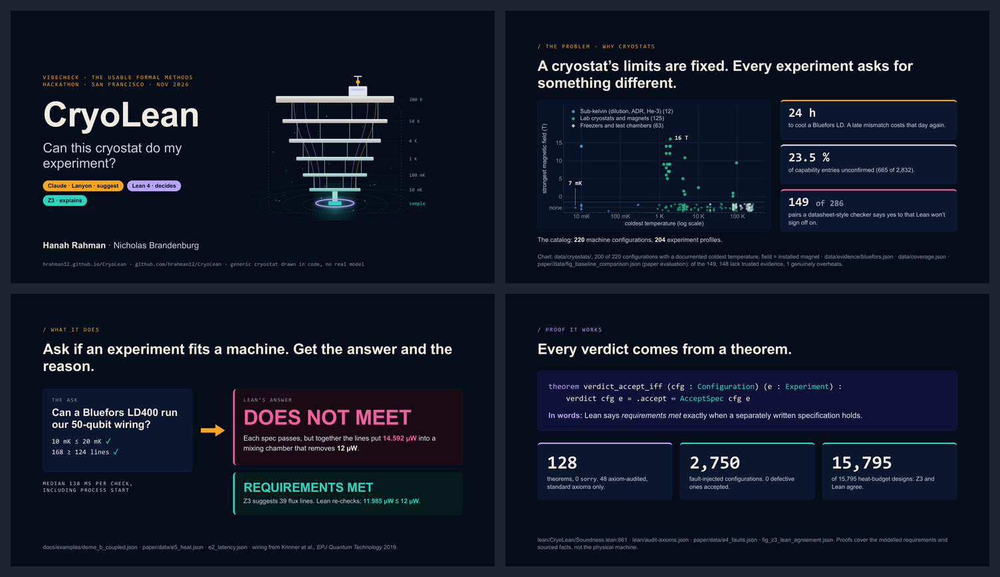
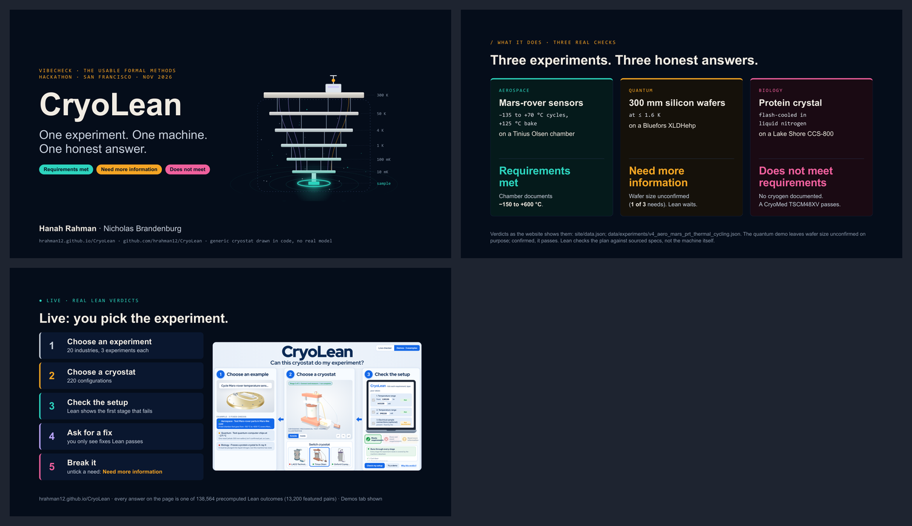
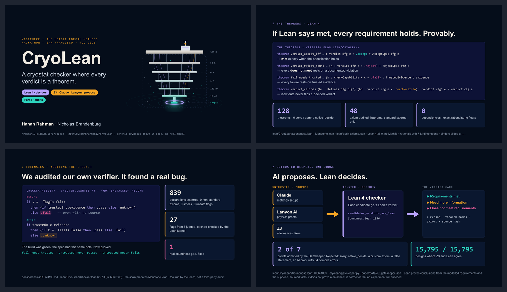
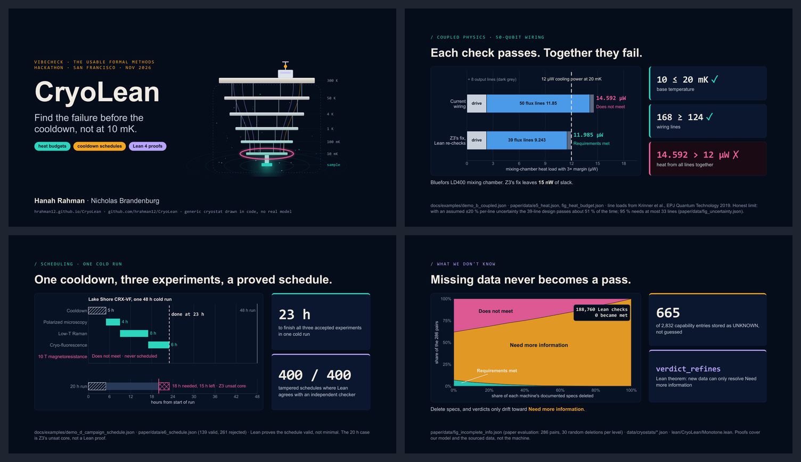
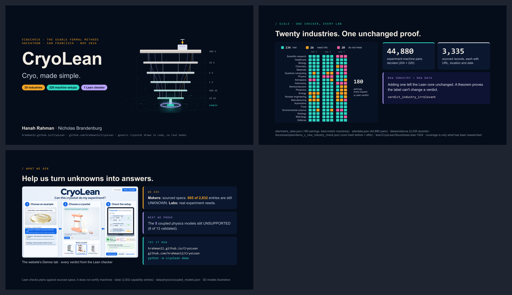

# CryoLean pitch decks

Five short pitches for Vibecheck, the usable formal methods hackathon (San Francisco, Nov 2026). Each deck is 3–4
widescreen slides in a PDF, made in the visual format of the LeanKeel pitch, and is meant to be presented in one minute.
Every deck folder has a `script.md` with a 60-second talk track.

| PDF | Slides | Angle | Audience |
|---|---|---|---|
| [v1 · Classic](CryoLean_pitch_v1_classic.pdf) | 4 | problem → what it does → every verdict is a theorem | general judges |
| [v2 · Demo-first](CryoLean_pitch_v2_demo.pdf) | 3 | three Demos-tab answers → live demo | before a live demo |
| [v3 · Formal methods](CryoLean_pitch_v3_formal.pdf) | 4 | the theorems → the self-audit bug → AI proposes, Lean decides | formal-methods judges |
| [v4 · Physics](CryoLean_pitch_v4_physics.pdf) | 4 | coupled heat budget → proved schedule → missing data never passes | cryogenics and quantum labs |
| [v5 · Vision and ask](CryoLean_pitch_v5_vision.pdf) | 3 | 20 industries, one proof → what we ask | sponsors and partners |







## Where the numbers come from

Every number is taken from the code on `main` (commits b2b80ff–c67ee63, 1 Nov 2026). [BRIEFS.md](BRIEFS.md) is the slide
plan, with each number and its source file. [facts/FACTS_quick.md](facts/FACTS_quick.md) is the fact sheet: each fact is
given with its source path and the evidence found. Some README and paper counts are out of date, and its corrections table
lists the current values: 48 audited theorems, not 44; 3,335 evidence records, not 667; 220 configurations and 204
experiment profiles.

## Layout

- `shared/`: the design system. `deck.css` sets 1456 × 819 slides, printed on 1440 × 810 pt pages.
  - `check.js`: layout check.
  - `render.py`: HTML → PDF → PNG, using headless Edge or Chrome.
  - `chartstyle.py`: dark matplotlib style.
  - `make_cryostat_svg.py`: the title-slide drawing.
  - `screenshot.py`: website screenshots.
  - `FORMAT.md`: the format rules.
- `v*/`: one folder per deck. Each holds `deck.html`, `build_charts.py` (charts are computed from the repo's data),
  `charts/` and `script.md`.
- `assets/site/demo-long@2x.png`: the Demos-tab screenshot that v2 and v5 crop.

## Rebuild a deck

```
python -m venv pitch/.venv
pitch/.venv/Scripts/python -m pip install matplotlib numpy pymupdf pillow
pitch/.venv/Scripts/python pitch/v1-classic/build_charts.py
pitch/.venv/Scripts/python pitch/shared/render.py pitch/v1-classic/deck.html --pdf pitch/CryoLean_pitch_v1_classic.pdf
```

`render.py` prints `RESULT: OK` when the layout check finds no clipped, overflowing or overlapping text, the page count
matches the slide count, and the page size is 1440 × 810 pt.
